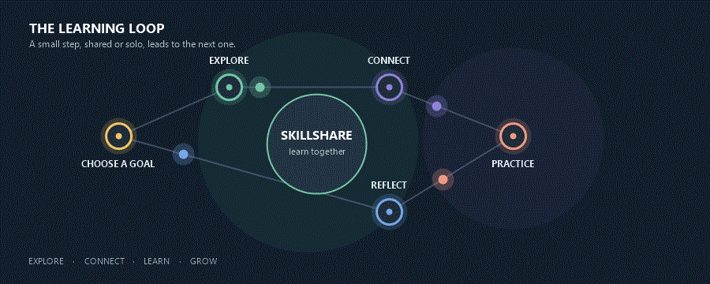
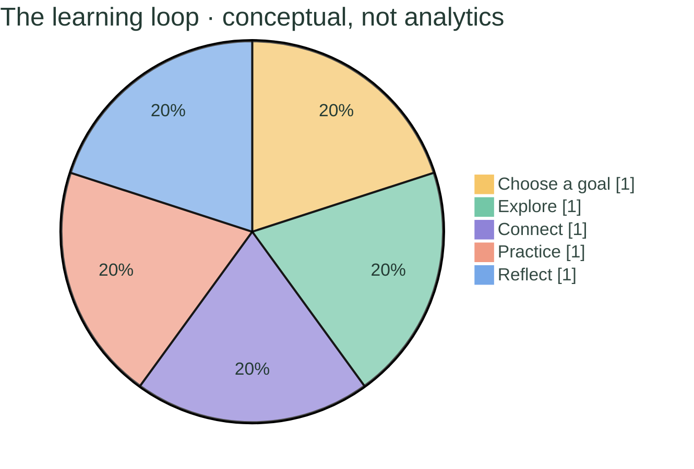
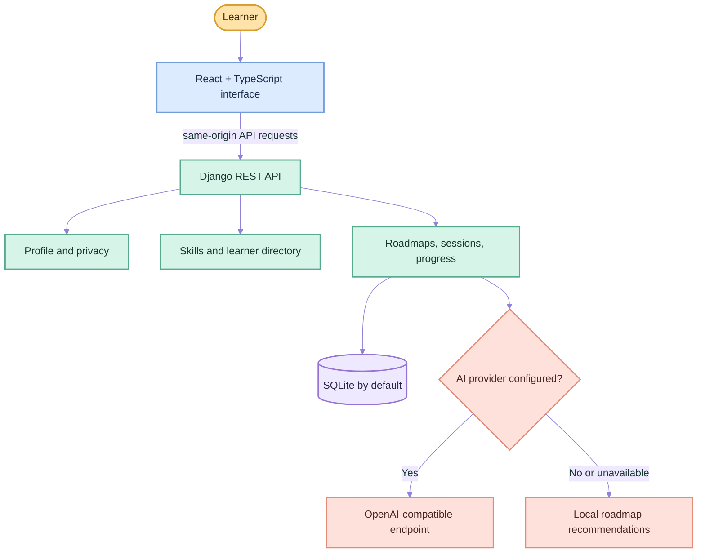

<div align="center">

# SkillShare

### A little progress, shared often, becomes real growth.

A peer-learning space to turn a curious idea into a study plan, a study partner, and a habit you can see.


**Explore · Connect · Learn · Grow**

[See the journey](#the-learning-journey) · [Start locally](#run-skillshare) · [Explore features](#what-you-can-do) · [Find routes](#pages-and-routes)

</div>

<p align="center">
  
</p>

<p align="center"><em>Start with an idea. Leave with a next step.</em></p>

---

## Your learning story, in motion

<p align="center">
  
</p>

### Every good learning story starts with a question

You want to learn something new, but the blank page is intimidating. SkillShare helps you find a first step. Build a roadmap for solo study, browse skills to see what's possible, or meet learners who are open to sharing what they know.

Then learning becomes a loop: choose a goal, make a plan, practice with intention, and notice your progress. When you want company, request a peer session and learn together.

## The learning journey

```mermaid
%%{init: {'theme': 'base', 'themeVariables': {'primaryColor': '#DDF5EC', 'primaryTextColor': '#18352E', 'primaryBorderColor': '#55A98C', 'lineColor': '#7B74C8', 'secondaryColor': '#EEE9FF', 'tertiaryColor': '#FFF1D6', 'fontFamily': 'ui-sans-serif, system-ui'}}}%%
flowchart LR
    A([A goal]) --> B{Pick your path}
    B -->|Plan it| C[Build a roadmap]
    B -->|Find a skill| D[Explore the catalog]
    C --> E[Practice in small steps]
    D --> F[Meet an opted-in learner]
    F --> G[Request a session]
    G --> H{They respond}
    H -->|Accept| I[Learn together]
    H -->|Decline| D
    I --> J[Record attendance]
    E --> K[See your progress]
    J --> K
    K --> L([Choose what's next])
    L --> B

    classDef start fill:#FFE3A8,stroke:#D89D32,color:#392A0D,stroke-width:2px
    classDef plan fill:#E8DEFF,stroke:#9473D4,color:#2D2145,stroke-width:2px
    classDef explore fill:#D7F4E9,stroke:#55A98C,color:#18352E,stroke-width:2px
    classDef connect fill:#FFE1DC,stroke:#E38B77,color:#48251F,stroke-width:2px
    classDef learn fill:#DDEBFF,stroke:#729BDC,color:#1C2F4D,stroke-width:2px
    classDef progress fill:#E9F6C9,stroke:#92B34D,color:#293917,stroke-width:2px
    class A,L start
    class B plan
    class C,E plan
    class D explore
    class F,G,H connect
    class I,J learn
    class K progress
```



### The loop at a glance

This pie is a **conceptual map of the five learning moments**, with equal slices to show that each is part of the loop. It is not a chart of user activity or measured results.



## What you can do

| Your next step | How SkillShare helps |
|---|---|
| **Find a direction** | Search the skill catalog and filter by category. |
| **Meet a learner** | Browse profiles shared by learners who opted into the directory. Search by skill, learning direction, and experience. |
| **Learn together** | Request a peer session with a topic and suggested time. The other learner can accept or decline; you can cancel a pending request. |
| **Make a plan** | Generate a structured roadmap and save tasks to your account. A local recommendation fallback works without an AI key. |
| **Notice your progress** | Review completed roadmap tasks, recorded practice, session attendance, and your learning streak. |
| **Make it yours** | Choose a light or dark theme. The responsive interface supports keyboard access and reduced-motion preferences. |
| **Enjoy the details** | Explore the 3D home-page map, animated transitions, dashboard ambience, and site-wide cursor treatment. |

> **A clear privacy choice:** profiles are private by default. Email and contact details are not shown in the public learner directory.

## How the pieces fit



## Run SkillShare

### You will need

- Python **3.12 or newer**
- Node.js **20 or newer**
- SQLite (included with Python), or PostgreSQL if you choose to configure it

You can run the app without a paid AI key.

### 1. Set up the backend

From the project root in PowerShell (`D:\Hackton`):

```powershell
py -3 -m venv .venv
.\.venv\Scripts\python.exe -m pip install -r requirements.txt
if (!(Test-Path backend\.env)) { Copy-Item .env.example backend\.env }
.\.venv\Scripts\python.exe backend\manage.py migrate
.\.venv\Scripts\python.exe backend\manage.py runserver 8000
```

Leave that terminal running. The example configuration uses SQLite and does not require an AI credential. Add provider settings to `backend\.env` only if you want AI-assisted roadmap suggestions; keep real credentials out of source files.

### 2. Start the frontend

Open a second PowerShell terminal in the project root:

```powershell
npm install
npm run dev
```

Visit **http://localhost:5173**. Vite proxies `/api` and `/admin` to Django on port `8000`, so the browser uses one origin for session cookies.

### 3. Take your first step

Create an account, choose a learning goal, and either make a roadmap or explore skills. To see the peer directory, you can optionally add clearly marked demo learners below.

<details>
<summary><strong>Optional: add sample learners</strong></summary>

After migrations, run this once in a local demo database:

```powershell
.\.venv\Scripts\python.exe backend\manage.py seed_demo --password "Choose-A-Unique-Local-Demo-Password"
```

This creates `demo_mentor`, `demo_designer`, `demo_builder`, and `demo_learner` with reserved `.invalid` email addresses. Choose a local-only password you do not use elsewhere. The command is optional; no demo accounts are created automatically.

</details>

<details>
<summary><strong>Optional: open Django admin</strong></summary>

Create an administrator from the project root:

```powershell
.\.venv\Scripts\python.exe backend\manage.py createsuperuser
```

Then visit **http://localhost:8000/admin/**.

</details>

<details>
<summary><strong>Optional: run project checks</strong></summary>

```powershell
.\.venv\Scripts\python.exe backend\manage.py check
.\.venv\Scripts\python.exe backend\manage.py test core
.\.venv\Scripts\python.exe backend\manage.py makemigrations --check --dry-run
npm run lint
npm run build
```

The root npm scripts `npm run backend`, `npm run migrate`, and `npm run test:backend` are also available when the Python virtual environment is active.

</details>

## Pages and routes

| Route | What you will find |
|---|---|
| `/` | Welcome page and interactive 3D skill map |
| `/explore` | Search and filter the skill catalog |
| `/students` | Browse learners who opted into the directory |
| `/students/:id` | Learner profile and session request form |
| `/register` · `/login` | Create an account or sign in |
| `/setup` · `/profile` | Profile details, skills, interests, learning formats, and visibility |
| `/dashboard` | Learning overview, roadmap, skills, and sessions |
| `/roadmaps/new` | Create a learning roadmap |
| `/roadmaps/:id` | Review a roadmap and update task completion |
| `/sessions` | Incoming and outgoing requests, scheduled sessions, and attendance |
| `/progress` | Recorded practice and roadmap progress |
| `/about` | About SkillShare and HACKER_RUN |

## The API behind the journey

- **Accounts:** `POST /api/auth/register/`, `POST /api/auth/login/`, `POST /api/auth/logout/`, `GET /api/auth/me/`
- **Profile:** `GET/PATCH /api/profile/me/`
- **Catalog:** `GET /api/skills/`, `GET /api/skills/categories/`
- **Learners:** `GET /api/students/`, `GET /api/students/<user_id>/`
- **Peer sessions:** `GET/POST /api/learning-requests/`, `PATCH /api/learning-requests/<id>/`, `GET /api/sessions/`
- **Roadmaps:** `GET /api/roadmaps/`, `POST /api/roadmaps/generate/`, `GET/PATCH/DELETE /api/roadmaps/<id>/`, `PATCH /api/roadmaps/<id>/tasks/<task_id>/`
- **Progress:** `GET /api/progress/`, `POST /api/progress/practice/`

## AI roadmap suggestions

Set `AI_API_KEY`, `AI_BASE_URL`, and `AI_MODEL` in environment variables or `backend/.env` to use an OpenAI-compatible chat-completions endpoint. Credentials remain on the backend.

Without a key, when the provider is unavailable, or when its response cannot be parsed, SkillShare creates a structured local roadmap and marks it as a local recommendation.

## Database

SQLite is the default. For PostgreSQL, set `DB_ENGINE=postgresql` and configure `DB_NAME`, `DB_USER`, `DB_PASSWORD`, `DB_HOST`, and `DB_PORT`. The PostgreSQL driver is included in `requirements.txt`; run the usual Django migrations against your chosen database.

## Before production

This repository is set up for local development. Before deploying, configure a unique `DJANGO_SECRET_KEY`, set `DJANGO_DEBUG=false`, and configure `DJANGO_ALLOWED_HOSTS`, `DJANGO_CORS_ALLOWED_ORIGINS`, and `DJANGO_CSRF_TRUSTED_ORIGINS`. Serve over HTTPS and use a supported production database with backups. Build the Vite frontend and route `/api` and `/admin` through your production web server.

Production cookie security flags are enabled when debug is off. This project does not include email verification, password reset, hosted video, built-in real-time messaging, or a production deployment pipeline. Roadmap suggestions are recommendations, not guaranteed outcomes.

---

<div align="center">

**Built for curious minds, by HACKER_RUN.**

*Explore something new. Share what you know. Keep growing.*

</div>
