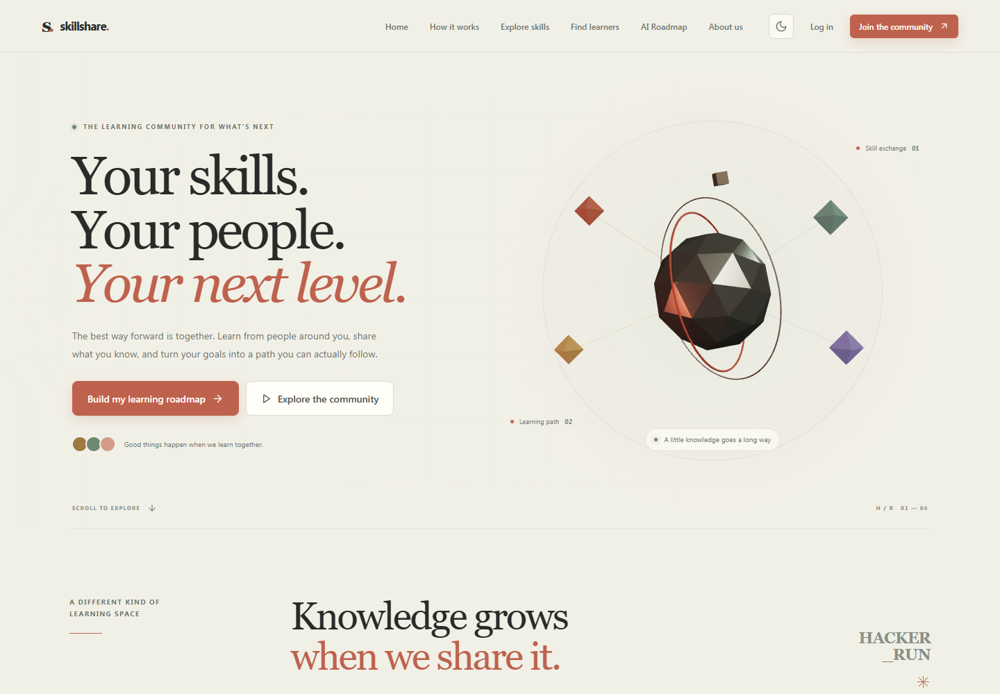

<div align="center">

# ✨ SkillShare

### Learn together. Grow together.

A peer-learning community for sharing skills, building practical study plans, and making progress with other learners.


**Explore · Connect · Learn · Grow**

[Get started](#-quick-start) · [Website preview](#-website-preview) · [Study flow](#-the-study-flow) · [Features](#-what-you-can-do) · [Routes](#-pages-and-routes) · [API](#-api-at-a-glance)

</div>

---

## 🖼️ Website preview

<p align="center">
  
</p>

<p align="center"><em>Explore skills, build a roadmap, and grow together.</em></p>

---

## 🌈 Welcome to your learning space

**SkillShare** is a full-stack learning app by **HACKER_RUN**. Learners can explore a shared skill catalog, choose whether to appear in the community directory, request peer sessions, create AI-assisted roadmaps, and track their own progress.

The home page includes an interactive 3D learning map built with Three.js, React Three Fiber, and Drei. The rest of the experience works without a paid AI key or a WebGL-capable browser.

## 🧭 The study flow

```mermaid
flowchart LR
    A([🎯 Choose a goal]) --> B{How would you like to learn?}
    B -->|Build a plan| C[✨ Generate a roadmap]
    B -->|Learn with a peer| D[🔎 Explore skills]
    C --> E[🪜 Work through roadmap tasks]
    D --> F[👋 Find an opted-in learner]
    F --> G[✉️ Request a session with a topic and time]
    G --> H{Peer response}
    H -->|Declines| D
    H -->|Accepts| I[📅 Session appears in Sessions]
    I --> J[🤝 Study together at the agreed time]
    J --> K[✅ Record attendance]
    E --> L[📝 Log practice]
    K --> M[📈 Dashboard and progress update]
    L --> M
    M --> N([🌱 Choose your next step])
    N --> B

    classDef goal fill:#FFD166,stroke:#D99400,color:#26221B,stroke-width:2px
    classDef choose fill:#FFF1B8,stroke:#C79B26,color:#342D16,stroke-width:2px
    classDef plan fill:#D8C5FF,stroke:#8C68D9,color:#251B38,stroke-width:2px
    classDef explore fill:#A8DADC,stroke:#42979B,color:#142B2B,stroke-width:2px
    classDef connect fill:#FFB4A2,stroke:#D66F5B,color:#321C17,stroke-width:2px
    classDef learn fill:#BDE0FE,stroke:#5A9AD0,color:#14283B,stroke-width:2px
    classDef progress fill:#C7F9CC,stroke:#56A764,color:#17321C,stroke-width:2px
    class A,N goal
    class B choose
    class C,E plan
    class D explore
    class F,G,H,I connect
    class J,K,L learn
    class M progress
```



> **Peer sessions:** SkillShare records requests, topics, suggested times, responses, and attendance. Learners meet using their own preferred tools; the app does not currently provide built-in real-time chat or video calls.

## 🎨 What you can do

| | Feature | What it does |
|---|---|---|
| 🧭 | **Explore skills** | Search the catalog and filter by category. |
| 👥 | **Meet learners** | Find public profiles by skill, learning direction, and experience. Profiles stay private until their owner opts in. |
| 🤝 | **Request a peer session** | Suggest a topic and future time; the recipient can accept or decline, and the sender can cancel a pending request. |
| 🗺️ | **Build a roadmap** | Generate a structured learning path and save tasks to your account. A deterministic local fallback works without an AI key. |
| ✅ | **Track progress** | See completed roadmap tasks, recorded practice, session attendance, and your learning streak. |
| 🎛️ | **Make it yours** | Switch between dark and light themes. The interface is responsive, keyboard-accessible, and honors reduced-motion settings. |
| 🪄 | **Enjoy the details** | Explore the 3D home-page map, animated page transitions, dashboard ambience, and site-wide desktop cursor treatment. |

### 🔐 Privacy and account basics

- Registration, sign-in, and sign-out use Django sessions and CSRF protection.
- Passwords are validated and hashed by Django.
- Learner profiles are private by default. Email and contact details are never shown in the public directory.
- Demo accounts are created only when you run the optional seed command; none are added automatically.

## ⚡ Quick start

### Requirements

- Python **3.12+**
- Node.js **20+**
- SQLite (included with Python) or an optional PostgreSQL database

No paid API key is needed to run the local app.

### 1. Set up Django

Open PowerShell in the project root (`D:\Hackton`):

```powershell
py -3 -m venv .venv
.\.venv\Scripts\python.exe -m pip install -r requirements.txt
if (!(Test-Path backend\.env)) { Copy-Item backend\.env.example backend\.env }
.\.venv\Scripts\python.exe backend\manage.py migrate
.\.venv\Scripts\python.exe backend\manage.py runserver 8000
```

Keep this terminal open. The example environment uses SQLite and no AI credential. Edit `backend\.env` only if you want provider-backed roadmap suggestions; keep real credentials out of source files.

### 2. Start the frontend

Open a second PowerShell terminal in `D:\Hackton`:

```powershell
npm install
npm run dev
```

Open **http://localhost:5173**. Vite proxies `/api` and `/admin` to Django on port `8000`, so the frontend and API share an origin for session cookies.

### 🌱 Optional: add sample learners

The default database includes a starter skill catalog and no fabricated learner accounts. To populate the learner directory with four clearly marked demo profiles, run this once after migrations:

```powershell
.\.venv\Scripts\python.exe backend\manage.py seed_demo --password "Choose-A-Unique-Local-Demo-Password"
```

This creates `demo_mentor`, `demo_designer`, `demo_builder`, and `demo_learner`, using reserved `.invalid` email addresses. Use a local-only password you do not use anywhere else. Run the command only in a demo database.

### 🛠️ Optional: Django admin

Create an administrator from the project root:

```powershell
.\.venv\Scripts\python.exe backend\manage.py createsuperuser
```

Then visit **http://localhost:8000/admin/**.

## 🧪 Checks and useful commands

Run these from the project root:

```powershell
.\.venv\Scripts\python.exe backend\manage.py check
.\.venv\Scripts\python.exe backend\manage.py test core
.\.venv\Scripts\python.exe backend\manage.py makemigrations --check --dry-run
npm run lint
npm run build
```

The root npm scripts `npm run backend`, `npm run migrate`, and `npm run test:backend` are also available when the Python virtual environment is activated.

## 🗺️ Pages and routes

| Route | Page |
|---|---|
| `/` | Welcome page and interactive 3D skill map |
| `/explore` | Search and filter the skill catalog |
| `/students` | Browse learners who opted into the directory |
| `/students/:id` | Learner profile and session request form |
| `/register` · `/login` | Create an account or sign in |
| `/setup` · `/profile` | Set profile details, skills, interests, learning formats, and visibility |
| `/dashboard` | Learning overview, roadmap, skills, and sessions |
| `/roadmaps/new` | Create a learning roadmap |
| `/roadmaps/:id` | Review a roadmap and update task completion |
| `/sessions` | Incoming and outgoing requests, scheduled sessions, and attendance |
| `/progress` | Recorded practice and roadmap progress |
| `/about` | About SkillShare and HACKER_RUN |

## 🔌 API at a glance

- **Accounts:** `POST /api/auth/register/`, `POST /api/auth/login/`, `POST /api/auth/logout/`, `GET /api/auth/me/`
- **Profile:** `GET/PATCH /api/profile/me/`
- **Catalog:** `GET /api/skills/`, `GET /api/skills/categories/`
- **Learners:** `GET /api/students/`, `GET /api/students/<user_id>/`
- **Peer sessions:** `GET/POST /api/learning-requests/`, `PATCH /api/learning-requests/<id>/`, `GET /api/sessions/`
- **Roadmaps:** `GET /api/roadmaps/`, `POST /api/roadmaps/generate/`, `GET/PATCH/DELETE /api/roadmaps/<id>/`, `PATCH /api/roadmaps/<id>/tasks/<task_id>/`
- **Progress:** `GET /api/progress/`, `POST /api/progress/practice/`

## 🧠 AI roadmap configuration

The backend reads `AI_API_KEY`, `AI_BASE_URL`, and `AI_MODEL` from environment variables or `backend/.env`. The default base URL is an OpenAI-compatible chat-completions endpoint. Credentials stay on the backend.

If no key is configured, the provider is unavailable, or its response cannot be parsed, SkillShare builds a structured deterministic roadmap locally and marks it as a local recommendation.

## 🗄️ Database options

SQLite is the default. To use PostgreSQL, set `DB_ENGINE=postgresql` plus `DB_NAME`, `DB_USER`, `DB_PASSWORD`, `DB_HOST`, and `DB_PORT`. The PostgreSQL driver is included in `requirements.txt`; run the same Django migrations against the chosen database.

## 🚀 Before production

This repository is configured for local development. Before deploying, set a unique `DJANGO_SECRET_KEY`, set `DJANGO_DEBUG=false`, configure `DJANGO_ALLOWED_HOSTS`, `DJANGO_CORS_ALLOWED_ORIGINS`, and `DJANGO_CSRF_TRUSTED_ORIGINS`, serve over HTTPS, and configure a supported production database with backups. Build the Vite frontend and route `/api` and `/admin` through your production web server.

Production cookie security flags are enabled when debug is off. This demo does not include email verification, password reset, hosted video, built-in real-time messaging, or a production deployment pipeline. Roadmap suggestions are learning recommendations and do not guarantee a particular outcome.

---

<div align="center">

**Made for curious minds, by HACKER_RUN.** 🌱✨🎨

</div>
